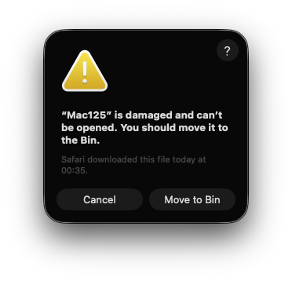

# Mac125 Releases

Official macOS downloads, release notes and installation guidance for Mac125, the free native Mac app for the Uniden UBC125XLT. This repository contains release artifacts and documentation, not source code.

## Current release: Mac125 v0.5.3 (5)

[Download the universal Mac DMG](https://github.com/reflectingme/Mac125/releases/download/v0.5.3/Mac125_v0.5.3_macos.dmg) · [Release notes](RELEASE_NOTES_v0.5.3.md) · [Checksums](SHA256SUMS_v0.5.3.txt)

One app contains both Apple Silicon (`arm64`) and Intel (`x86_64`) architectures, with a macOS 12.0 deployment minimum. A universal build does not establish runtime compatibility on every Mac: Intel/Monterey hardware validation remains unconfirmed. Keep the previous working app and your channel exports/backups for rollback.

Mac125 is distributed directly through GitHub Releases, not the App Store. This release is locally ad-hoc signed; it is **not Developer ID signed or notarised**. An ad-hoc signature is not publisher authentication.

## Install manually

1. Quit Mac125 and any other scanner client. Keep your previous working app separately before replacing it.
2. Download `Mac125_v0.5.3_macos.dmg` and verify its checksum below.
3. Open the DMG and drag `Mac125.app` to the Applications link. The included `INSTALL.txt` contains installation, rollback and first-launch guidance.
4. Eject the DMG, then open `/Applications/Mac125.app`.
5. Connect explicitly when ready. Importing files or restoring a backup to the local table never writes to the scanner automatically. Scanner writes require their own reviewed confirmation.

### If macOS blocks opening

Use only a copy from a source you trust. Try Finder’s right-click **Open**, or **System Settings → Privacy & Security → Open Anyway** where available.



For a trusted copy only, the established manual quarantine fallback is:

```sh
xattr -dr com.apple.quarantine /Applications/Mac125.app
```

Do not disable Gatekeeper globally. A “damaged” or “cannot be opened” warning is not proof that quarantine is the only problem. If the app still fails, inspect its launch/crash diagnostics and seek support.

## Verify the download

Download `SHA256SUMS.txt` beside the DMG from the same release. In the directory containing both files, run:

```sh
shasum -a 256 -c SHA256SUMS.txt
```

The result should say `Mac125_v0.5.3_macos.dmg: OK`. Checksums detect file changes; they do not independently establish who supplied the file. Versioned checksum files remain available for older releases.

## Updates and rollback

Mac125 checks GitHub Releases once per launch after the welcome closes or is skipped. A newer-version notice offers **Later**, **Download Latest** and an option to ignore that exact release. The browser opens only when you choose a download or support link. Offline and failed checks remain quiet.

Downloads and installation remain manual. Mac125 never automatically downloads, installs, replaces or relaunches itself. Keep the previous working app and backups; returning to an older app does not undo scanner writes. Run only one scanner client at a time.

## Support

- Website: <https://gw3jvb.uk/software/mac125/>
- Email: `gw3jvb@gmail.com`
- Discord: <https://discord.gg/d5TcV7eNSS>

## Support development

Mac125 remains free to use.

- PayPal: <https://www.paypal.com/paypalme/JohnVincentBurns>
- Buy Me a Coffee: <https://www.buymeacoffee.com/reflectingme>
